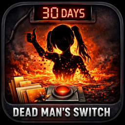
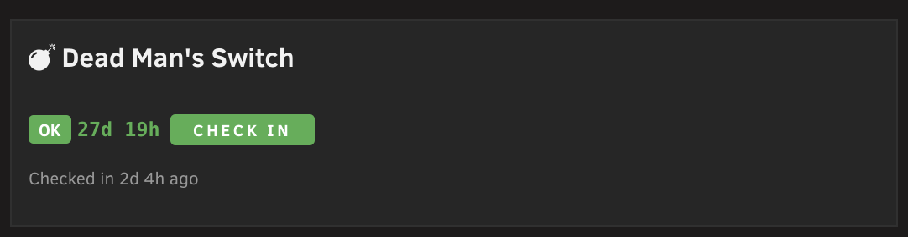
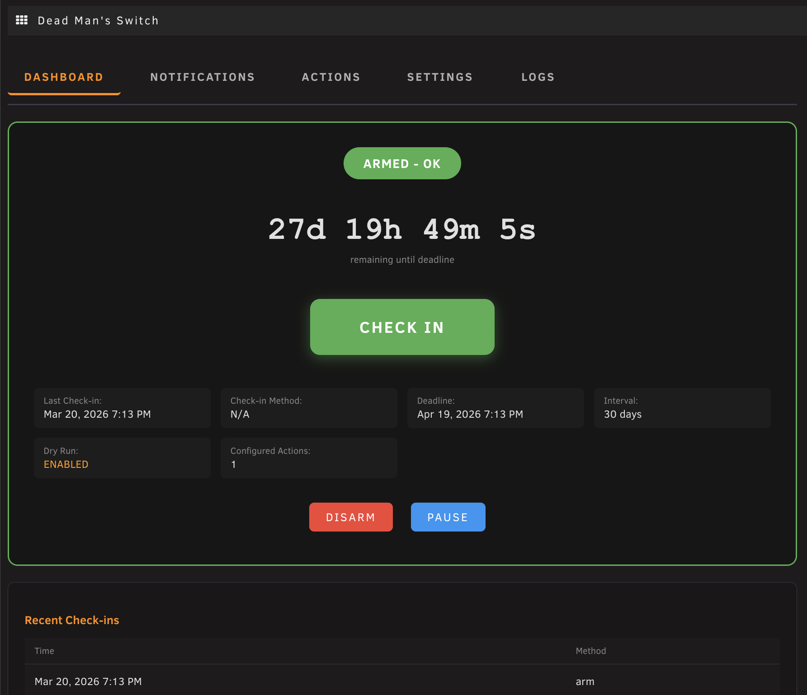
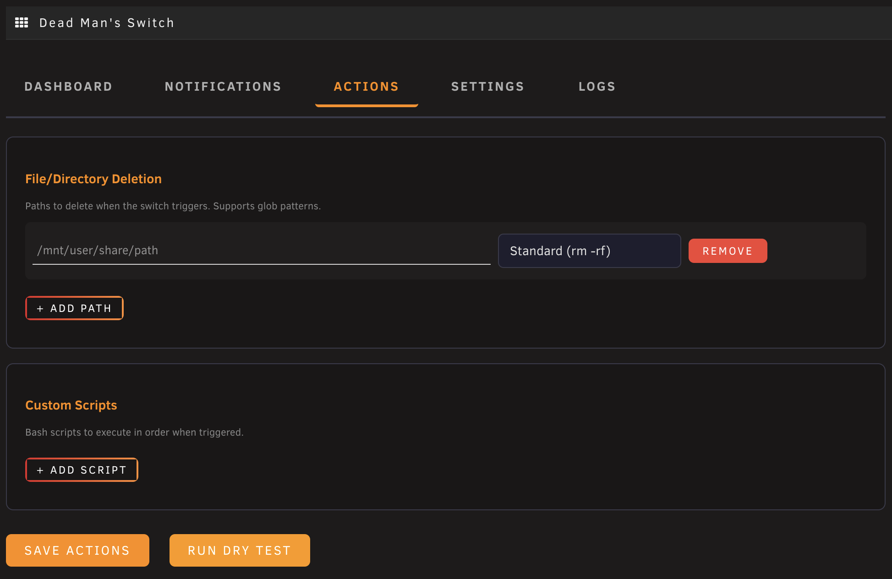
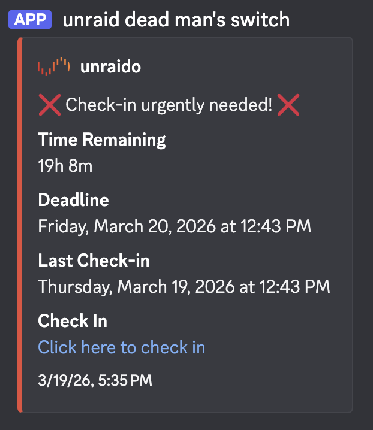
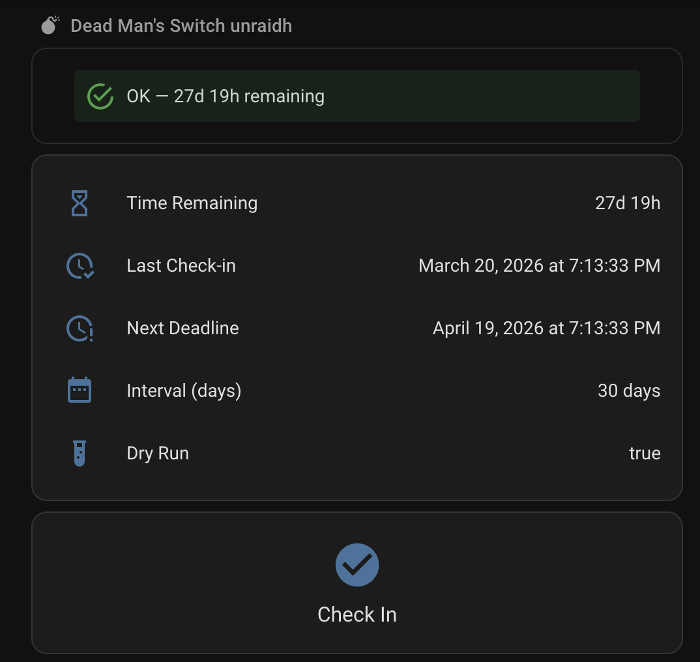
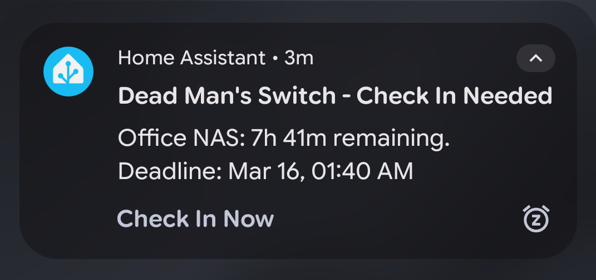

<p align="center">
  
</p>

# Dead Man's Switch for Unraid

A dead man's switch plugin for Unraid that requires periodic check-ins. If you stop checking in, it triggers configurable actions — like deleting files or running scripts — after a deadline passes.

Useful for privacy-conscious users who want automated cleanup if they become unable to manage their server.

## Screenshots

### Unraid Dashboard Tile


### Plugin Dashboard


### Actions Configuration


### Discord Notifications


## Features

- **Configurable check-in interval** — set how many days between required check-ins (default: 30)
- **Grace period** — extra hours after the deadline before actions trigger
- **Trigger actions** — delete files/folders (with glob pattern support) or run custom bash scripts
- **Dry run mode** — test your entire configuration safely before going live; run a dry test from the Actions tab to see exactly what would happen without actually deleting anything
- **Arm / Disarm / Pause controls** — full lifecycle management; the remaining time is frozen while paused, and pausing an already-paused switch extends the pause
- **Double-miss protection** — optionally require two consecutive missed deadlines before triggering
- **Corruption protection** — a backup (`.bak`) of the last good state and config is kept; a corrupt state file is restored from it and the switch is disarmed until you verify and re-arm
- **Dashboard tile** — real-time countdown on the Unraid dashboard

### Notifications

- **Discord webhooks** — rich embeds with severity-matched colors and quick check-in links
- **Custom webhooks** — send notifications to any HTTP endpoint with configurable method and body template
- **Uptime Kuma** — push heartbeat monitoring so you can track check-in health externally
- **Warning thresholds** — configurable alerts at 50%, 75%, 90%, and 95% of elapsed time

### External API

- Runs on **port 3801**, separate from Unraid's authenticated nginx
- API key protected endpoints (`X-Api-Key` header) for remote check-ins and status queries
- Token-based quick check-in URLs (included in Discord notifications) that open a confirmation page
- CORS enabled for Home Assistant and browser clients

## Installation

In the Unraid web UI, go to **Plugins > Install Plugin** and paste:

```
https://raw.githubusercontent.com/dereckhall/unraid-deadmans-switch/main/plugin/deadman-switch.plg
```

Requires **Unraid 6.12.0** or later.

## Configuration

After installation, go to **Settings > Dead Man's Switch**. The UI has five tabs:

| Tab | Description |
|-----|-------------|
| **Dashboard** | Live countdown, check-in button, arm/disarm/pause controls |
| **Notifications** | Discord webhooks, custom webhooks, Uptime Kuma push URL, warning thresholds |
| **Actions** | File/folder deletions (glob patterns supported) and custom script executions, with dry run testing |
| **Settings** | Check-in interval, grace period, cron frequency, dry run toggle, API key management |
| **Logs** | Recent activity and check-in history |

## API Reference

The plugin runs a lightweight API server on **port 3801** for remote access without Unraid authentication.

| Endpoint | Auth | Description |
|----------|------|-------------|
| `?action=health` | None | Health check, returns version |
| `?action=status` | API key (`X-Api-Key` header; `&key=` still accepted) | Current switch status and countdown |
| `?action=checkin` | API key (`X-Api-Key` header; `&key=` still accepted) | Perform a check-in |
| `?action=get_state` | API key (`X-Api-Key` header; `&key=` still accepted) | Full state JSON |
| `?action=quickcheckin&token=TOKEN` | Token | Quick check-in link: opens a confirmation page whose button records the check-in |

```bash
# Check status
curl -H "X-Api-Key: YOUR_API_KEY" "http://YOUR_UNRAID_IP:3801/?action=status"

# Perform a check-in
curl -H "X-Api-Key: YOUR_API_KEY" "http://YOUR_UNRAID_IP:3801/?action=checkin"
```

- Prefer the header: a key passed as `&key=` in the URL ends up in browser history and reverse-proxy access logs. The query-string form still works for existing setups.
- API and web UI check-ins are refused while the switch is disarmed or has triggered — after a trigger, disarm and re-arm first.
- Opening a quick check-in link only shows the confirmation page; the check-in happens when you press its button (a POST). A plain GET never records a check-in and other methods (e.g. HEAD) get `405`, so link previews and URL scanners can no longer check in for you or use up the link.
- From a shell on the server: `/usr/local/emhttp/plugins/deadman-switch/scripts/checkin.sh [method]` (the optional method is recorded in the check-in history; default `cli`).
- The authenticated Unraid-side endpoint `include/api.php?action=status` returns the same field names as the port-3801 `status` (only relevant if you call it directly).

## Home Assistant Integration

The external API makes it easy to integrate with Home Assistant using REST sensors, automations, and actionable notifications.

<p float="left">
  
  
</p>

<details>
<summary>REST sensor + check-in command</summary>

Add to `configuration.yaml`, then restart Home Assistant (or reload YAML configuration):

```yaml
rest:
  - scan_interval: 60
    resource: "http://YOUR_UNRAID_IP:3801/?action=status"
    method: GET
    headers:
      X-Api-Key: YOUR_API_KEY
    sensor:
      - name: "DMS Status"
        unique_id: "dms_status"
        value_template: "{{ value_json.status }}"
        json_attributes:
          - armed
          - paused
          - dry_run
          - warning_level
          - days_remaining
          - time_remaining_display
          - last_checkin
          - next_deadline
          - elapsed_pct
          - checkin_interval_days

rest_command:
  dms_checkin:
    url: "http://YOUR_UNRAID_IP:3801/?action=checkin"
    method: GET
    headers:
      X-Api-Key: YOUR_API_KEY
```

</details>

### Status card and check-in button

Add these cards to your dashboard via **Dashboard → Edit → Add Card → Manual**. Stacking a few small cards gives a clean status readout plus a one-tap check-in.

A markdown card turns the raw status (e.g. `armed_ok`) into a colored alert with the time remaining:

```yaml
type: markdown
content: >
  
  
  {% set info = {
    'armed_ok': {'label': 'OK - ' ~ remaining ~ ' remaining', 'type': 'success'},
    'armed_reminder': {'label': 'Reminder - ' ~ remaining ~ ' remaining', 'type': 'warning'},
    'armed_warning': {'label': 'Warning - ' ~ remaining ~ ' remaining', 'type': 'warning'},
    'armed_critical': {'label': 'Critical - ' ~ remaining ~ ' remaining', 'type': 'error'},
    'grace_period': {'label': 'Grace Period - ' ~ remaining ~ ' remaining', 'type': 'error'},
    'triggered': {'label': 'TRIGGERED - deleted files', 'type': 'error'},
    'paused': {'label': 'Paused - ' ~ remaining ~ ' remaining', 'type': 'success'},
    'disarmed': {'label': 'Disarmed', 'type': 'success'}
  } %}
  
  <ha-alert alert-type="{{ i.type }}">
  {{ i.label }}
  </ha-alert>
```

An entities card shows the details:

```yaml
type: entities
entities:
  - entity: sensor.dms_status
    type: attribute
    attribute: time_remaining_display
    name: Time Remaining
    icon: mdi:timer-sand
  - entity: sensor.dms_status
    type: attribute
    attribute: last_checkin
    name: Last Check-in
    icon: mdi:clock-check-outline
  - entity: sensor.dms_status
    type: attribute
    attribute: next_deadline
    name: Next Deadline
    icon: mdi:clock-alert-outline
```

And a button card for the check-in. It uses a confirmation prompt so an accidental tap won't reset the timer:

```yaml
type: button
name: Check In
icon: mdi:check-circle
tap_action:
  action: perform-action
  perform_action: rest_command.dms_checkin
  confirmation:
    text: Are you sure you want to check in to the Dead Man's Switch?
```

Tap the button, confirm, and it hits the check-in endpoint and resets your timer. The sensor refreshes on its next poll (every 60 seconds above). You can fire the same `rest_command.dms_checkin` from an automation or an actionable mobile notification to get a check-in button right on your phone's lock screen when the timer runs low.

## How It Works

1. **Arm** the switch and perform your first check-in
2. A cron job runs periodically (default: every 60 minutes) to evaluate the countdown
3. As the deadline approaches, notifications fire at configurable warning thresholds
4. If you check in before the deadline, the timer resets
5. While paused, the remaining time is frozen — the deadline moves out by the length of the pause. The Dashboard tab shows **PAUSED**, **GRACE PERIOD** and **TRIGGERED** states correctly
6. If the deadline passes (plus grace period), configured trigger actions execute — at most once per boot, even if the flash drive cannot record that the switch triggered
7. With double-miss enabled, the first miss sends a warning and resets the timer. If the warning cannot be delivered, it is retried until the grace period ends; then the timer resets anyway and an ERROR is logged, so a broken webhook cannot stall the switch
8. The API server self-heals — if the process dies, the cron job restarts it
9. Failures are loud: a failing cron evaluator or an unreadable or restored state file sends a webhook alert (once per boot), Uptime Kuma reports **down** when the state file is unreadable and mentions persistent notification failures, and every failed action in the web UI shows an error toast

### Files

Settings and state live on the flash drive in `/boot/config/plugins/deadman-switch/`:

- `config.json`, `state.json` — settings and switch state
- `config.json.bak`, `state.json.bak` — copy of the last good version of each, refreshed when a meaningful setting or state value changes. If `state.json` is found corrupt it is restored from `state.json.bak` and the switch is **DISARMED** as a precaution (see Troubleshooting)

Per-boot runtime files live in RAM in `/var/run/deadman-switch/`: the API server PID file (`api-server.pid`, moved off the flash drive), `alert.*` markers that limit failure alerts to once per boot, and the `triggered` marker that stops trigger actions running twice in one boot.

## Troubleshooting

### API server not running

The external API server on port 3801 should auto-start on install and self-heal via the cron job. If it's not running:

```bash
# Check if the process is alive (PID file is in RAM)
cat /var/run/deadman-switch/api-server.pid
ps aux | grep "external-api.php" | grep -v grep

# Manually restart it (the server runs in its own process group, so stop
# removes every worker and frees the port)
/usr/local/emhttp/plugins/deadman-switch/scripts/stop-api.sh
/usr/local/emhttp/plugins/deadman-switch/scripts/start-api.sh

# Check for port conflicts
lsof -i :3801
```

### Cron job not firing

The plugin installs a cron file at `/boot/config/plugins/deadman-switch/deadman-switch.cron`. If notifications or countdown checks aren't happening:

```bash
# Verify the cron file exists and has content
cat /boot/config/plugins/deadman-switch/deadman-switch.cron

# Rebuild cron from the plugin's cron file
/usr/local/sbin/update_cron
```

### Discord notifications not sending

1. Verify your webhook URL is correct in the Notifications tab
2. Use the **Test** button in the UI to send a test notification (it saves your settings first and only sends once the save succeeded)
3. Check the Logs tab for any error messages; a notification that failed on every channel also shows a banner on the Dashboard tab
4. Ensure your Unraid server has outbound internet access

### Switch disarmed after a restore, or "state.json is unreadable"

If `state.json` on the flash drive is found corrupt, it is restored from `state.json.bak` and the switch is **DISARMED** as a precaution — the backup may be older than your last check-in. A banner on the Settings page and a webhook alert (once per boot) tell you when this happens. Check the **Last Check-in** time on the Dashboard tab, then re-arm the switch.

If there is no usable `.bak`, the switch refuses to write anything (so the evidence is not overwritten), stops evaluating the countdown, and shows a red banner on the Settings page. Repair or delete the corrupt file in `/boot/config/plugins/deadman-switch/` and reload the page.

A corrupt `config.json` with a usable `config.json.bak` is restored from it and logged as an ERROR (the switch stays as it was) — review the Settings and Actions tabs. With no usable `.bak` it gets the same red banner as above.

### Actions not triggering (or triggering unexpectedly)

- Make sure **Dry Run** mode is off in the Settings tab if you want real execution
- Use the **Dry Test** button on the Actions tab to preview what would happen
- Glob patterns (`*`) do not match dotfiles/dotfolders — this is intentional for safety
- Check the Logs tab for trigger execution details

### Quick check-in link not working

Opening the link shows a confirmation page; the check-in is only recorded when you press its button. The link is single-use, and it shows an "inactive" page (without being used up) while the switch is disarmed or triggered.

By default the link points at your server's LAN address on port 3801, so it only works on your network. To use it away from home, set **External API URL** on the Settings tab to a public URL (reverse proxy or port forward) that routes to **port 3801, not the Unraid web UI**. A URL that reaches the normal Unraid web interface will not work.

### Plugin not updating

GitHub CDN can cache the PLG file. To force a fresh install:

```bash
curl -H 'Cache-Control: no-cache' -o /tmp/deadman-switch.plg \
  https://raw.githubusercontent.com/dereckhall/unraid-deadmans-switch/main/plugin/deadman-switch.plg
plugin install /tmp/deadman-switch.plg
```

## License

MIT License — see [LICENSE](LICENSE) for details.
